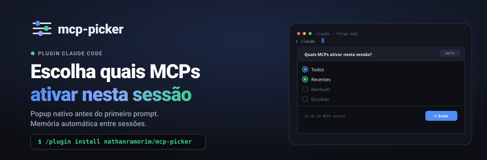

<p align="center">
  
</p>

<p align="center">
  <a href="https://github.com/nathanramorim/mcp-picker/releases"></a>
  
  
</p>

<h3 align="center">Escolha quais MCPs ativar<br>no início de cada sessão</h3>

---

## O que é

**mcp-picker** é um plugin para Claude Code que intercepta a conexão de servidores MCP antes do primeiro prompt. Ao iniciar uma sessão interativa, ele abre um popup nativo perguntando quais MCPs você quer ativar — e lembra da sua última escolha.

## Por que usar

| | |
|---|---|
| **Sessão mais limpa** | Ative só os MCPs que você vai usar; os outros ficam desligados e fora do caminho |
| **Memória automática** | A opção "Recentes" reusa sua última seleção com um clique |
| **Zero configuração** | Lê automaticamente os MCPs das suas `settings.json`; nada para editar |
| **Não-invasivo** | Sessões não-interativas (SDK, `-p`) ativam tudo — sem quebrar pipelines |

## Antes de começar

- [Claude Code](https://claude.ai/code) instalado (versão com suporte a plugins)
- Pelo menos um MCP configurado nas suas `settings.json`

## Instalação

```
/plugin install nathanramorim/mcp-picker
```

## Como usar

Ao iniciar uma sessão no Claude Code, um popup aparece automaticamente:

| Modo | O que faz |
|---|---|
| **Todos** | Ativa todos os MCPs configurados |
| **Recentes** | Reusa a última seleção salva |
| **Nenhum** | Inicia a sessão sem nenhum MCP |
| **Escolher** | Percorre seus MCPs em lotes de até 4 com multi-seleção |

Ao final, um toast confirma quantos MCPs estão ativos naquela sessão.

## Segurança e privacidade

- Lê apenas as chaves `mcpServers` dos arquivos `settings.json` locais — nenhum valor ou segredo é lido
- Nenhum dado é enviado para fora da máquina
- A seleção é persistida localmente via `$.store`, dentro do próprio Claude Code

## Versões

| Versão | Novidades |
|---|---|
| `0.1.0` | Lançamento inicial — popup nativo, 4 modos, memória entre sessões |

## Licença

[MIT](LICENSE)
